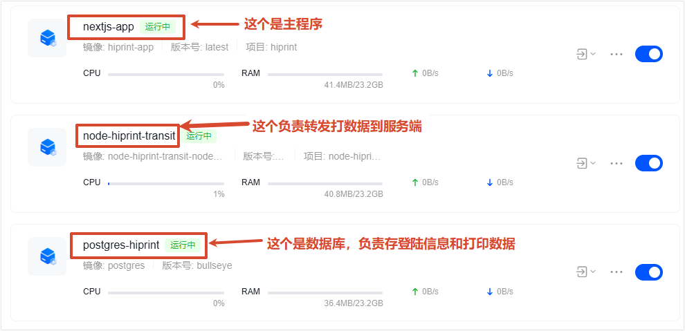

# 打印功能使用说明

## 首次使用前必须配置

本系统默认使用 `print2` 方式打印，PDF打印需要 Windows 打印机驱动里**预先创建好对应的纸张规格**，否则会打印会异常

### PDF模式打印时

1. 打开 Windows **"控制面板" → "设备和打印机"**
2. 右键点击您的打印机 → 选择 **"打印首选项"**
3. 找到 **"自定义纸张"** 或 **"纸张管理"** 选项卡
4. 点击 **"新建"**，根据您的标签模板创建纸张：

| 纸张名称    | 宽度 | 高度 |
| ----------- | ---- | ---- |
| laber_60x30 | 60mm | 30mm |
| laber_80x40 | 80mm | 40mm |
| laber_80x30 | 80mm | 30mm |

5. **纸张名称必须符合以上规则**：（`laber_**x**`）**替换实际尺寸

   

### 验证

配置完成后，点击打印按钮即可正常打印。如果仍然空白，请检查：
- **必须符合以上规则命名纸张和大小**
- 纸张尺寸是否正确

---

**注意：** 每添加一个新的标签模板尺寸，都需要在打印机驱动里创建对应的纸张规格。


## config

- **中转地址格式：**http://192.168.xxx.xxx:17521/

- **token:**`hiprint`


---


**技术栈是 Next.js + Drizzle ORM + PostgreSQL**

## Getting Started

First, run the development server:

```bash
npm run dev
```
---

### docker服务描述



